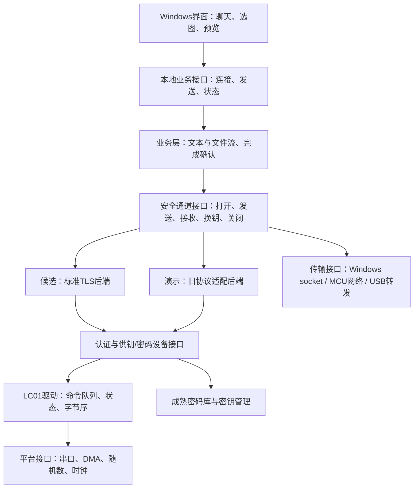

# 双设备安全通信软件架构调研草案

日期：2026-11-04（Asia/Shanghai）。状态：研究建议，待选型与验证；不表示新架构已实现。

## 1. 目标与现状

目标是构建两端独立的安全通信系统：先在两台Windows电脑上各接一块LC01验证，后续由每端MCU直接控制LC01并接管安全协议与业务加解密。电脑逐步退为聊天、选图、录音、显示及播放终端；中间阶段也可代转网络密文。

用户要求综合对标安全通信产品，不能只比较AES速度。应覆盖认证、密钥暴露范围、端到端握手、业务吞吐/延迟、RAM/Flash、换钥、故障恢复、功耗及维护成本。

当前v3.2仍是同进程双端演示：`CommunicationSession`/`_ChipPair`同时控制两路串口，`TextExchange`直接交付两端数据。`SecureEndpoint`已经具有单端密钥派生、确认、加解密和序号检查。尚无双电脑网络实现，真实双板互操作未验证。

v3.1/v3.2源码和发行文件继续作为历史基线。后续新核心在独立目录开发；本次仅新增调研文档，没有修改运行代码或打包文件。

## 2. 已核对的开源参考

下表基于官方仓库/文档的接口与源文件核查；尚未完成这些项目在目标MCU上的编译、移植或性能测量。正式选型必须锁定release、commit、配置和第三方文件许可证。

| 项目 | 可取之处 | 建议用途与限制 |
| --- | --- | --- |
| [DMTF/libspdm](https://github.com/DMTF/libspdm) | C99单端库、协议/密码/传输分层、由集成方提供缓冲、核心不动态分配内存 | 重点参考设备认证和会话边界；若采用SPDM则保持其规范。现有Mbed TLS包装层未实现PQC，LC01需适配；不支持把任意厂商算法直接冒充标准算法 |
| [Mbed TLS](https://github.com/Mbed-TLS/mbedtls)、[TF-PSA-Crypto](https://github.com/Mbed-TLS/TF-PSA-Crypto) | 成熟密码组件、密钥标识、可替换加速后端 | 优先评估MCU对称密码后端；应用不直接依赖内部结构。需验证所选版本的PQC/TLS能力，不能把PSA接口存在等同于LC01已经接入 |
| [wolfSSL](https://github.com/wolfSSL/wolfssl) | 嵌入式TLS、密码设备回调、部分异步操作支持 | 作为标准PQC TLS集成候选和对照实现；逐项核查LC01所需KEM/签名回调与异步支持，不由其他算法的支持推断。GPLv3/商业许可需纳入选型 |
| [wolfHSM](https://github.com/wolfSSL/wolfHSM) | 主机与安全端点的请求/响应、密码操作代理和密钥管理边界 | 参考电脑—MCU命令接口与密钥句柄；不会因采用接口便自动获得HSM级隔离。分立UART/SPI不能套用共享地址空间DMA指针方案 |
| [wireguard-lwip](https://github.com/smartalock/wireguard-lwip) | C核心、固定RAM、与lwIP解耦、平台回调简洁 | 参考定时器、重放窗口及传输抽象；不是LC01 PQC协议现成实现。替换其握手算法后不能继承WireGuard的互操作性与安全论证 |
| [lwIP](https://github.com/lwip-tcpip/lwip) | 嵌入式IP栈、事件与缓冲所有权管理 | 在实际网络硬件/驱动具备后接入；raw API的线程上下文限制需遵守，不能在网络回调里阻塞等待LC01 |
| [TinyUSB](https://github.com/hathach/tinyusb)、[HPM SDK](https://github.com/hpmicro/hpm_sdk) | USB本地业务通道、延迟处理中断事件、板级驱动 | 优先使用目标板SDK已经验证的USB后端，避免重复引入多套USB栈。USB与LC01控制通道分开 |
| [mlkem-native](https://github.com/pq-code-package/mlkem-native)、[mldsa-native](https://github.com/pq-code-package/mldsa-native) | 可移植C实现和标准算法测试，后者有RV32IM后端 | 标准PQC软件基线候选；不预设与旧版LC01算法互通，也不把其他架构性能搬到HPM。形式化验证范围以各仓库说明为准 |
| [pqm4](https://github.com/mupq/pqm4) | 自动化速度、栈与代码体积测量方法 | 参考测试方法与历史结果。仓库已公告停止活跃维护并计划归档，不作为新产品长期算法依赖；ARM周期数不能直接代表RISC-V |

许可证初筛：libspdm/HPM SDK为BSD-3-Clause；TinyUSB为MIT；Mbed TLS提供Apache-2.0或GPL-2.0-or-later选择；wolfSSL/wolfHSM的GPL或商业模式需单独评估。上游子模块与个别文件仍须逐项保留许可和归属，不根据仓库首页标签概括所有依赖。

## 3. 三条安全协议路线

### A. 标准协议直接调用LC01：长期优先验证

选定嵌入式TLS实现，让LC01经密码设备后端执行准确的标准KEM/签名操作；记录保护交给TLS，应用只负责文本/文件协议。

优势是减少自行维护安全记录层和状态规则的负担，并能测真正的标准互通。难点是LC01算法版本、格式、长度、签名语义、随机数及TLS库回调必须一致。当前`profiles.py`中多个KEM配置共用800/1632/768/32字节，不能仅按Kyber/Dilithium名称映射成ML-KEM/ML-DSA。

如果用途是设备认证/测量而不是通用聊天，可另外评估SPDM；不同时叠加TLS和SPDM以追求功能数量。

### B. LC01认证供钥，再接TLS外部PSK：兼容路线候选

在两个独立端点之间完成经过身份认证的LC01握手，将专用于TLS的派生PSK交给TLS 1.3，再进行文件/文本收发。不得把K或PSK经网络发给对方；两端各自派生。初始握手的身份信任、完整记录绑定和重放处理依然必须设计，TLS不能追溯修复一个未认证的供钥过程。

当前本机只读探测：Python 3.13.9、OpenSSL 3.6.1，`ssl.HAS_TLSv1_3=True`，PSK客户端/服务端回调属性均存在。这只是接口可用性探测；未实际跑TLS-PSK握手。

必要验证：

- 只允许所选TLS版本与密码套件，无PSK时必须失败，不自动退到另一种未批准认证方式。
- PSK绑定供钥握手摘要、两端身份/角色、用途、协议版本和选定哈希；每连接重新建钥，第一版禁用0-RTT和自动票据恢复。
- TLS_AES_256_GCM_SHA384使用SHA-384；不能机械沿用当前自定义AES-GCM记录层的SHA-256密钥调度。两端库必须能正确指定匹配的外部PSK哈希和密码套件。
- RFC 9258不仅规定派生上下文，还修改PSK binder标签；只有通用PSK回调不能据此声称实现了RFC 9258。若库不支持，应另行明确普通外部PSK配置及其绑定设计，而不是部分实现后冒充标准导入器。
- TLS KeyUpdate只更新TLS流量密钥，不等于LC01重新KEM；要求补充新PQC秘密时应明确执行新的LC01握手与安全通道切换。

本路线会增加一个供钥握手，未必比A低延迟；应测量后选，不提前宣布性能优势。

### C. LC01握手＋现有自定义AEAD记录：保留演示基线

现有HKDF/HMAC/AES-GCM代码可用于Python参考端和回归测试。可控、便于显示报文，但联网时需要自行实现认证信任、两端状态机、报文边界、换钥、关闭和故障规则，维护与安全分析成本更高。

不能因为减少握手消息、放宽认证或删去安全机制而宣称优于标准协议。此路线属于演示/研究协议；在完整评估前不定为产品安全协议。

### 当前建议

先构建共用的单端接口、流式业务层和测试工具，在最小互通试验中比较A/B；C继续作可解释的历史参考。每条连接固定一种协议配置，禁止在一条连接内动态拼接TLS密钥调度与旧AEAD记录规则。具体产品协议尚未批准选定。

## 4. 推荐软件分层

核心目标为C99、单端、事件驱动，由调用者提供缓冲；不依赖Tk、Python对象、文件路径、系统时间字符串或RTOS类型。C核心可在Windows编译为动态库/命令行测试端，再迁到MCU。Python保留界面、测试和参考实现。

概念接口包括：本地业务输入、网络字节输入、芯片完成事件、定时器事件，以及待发送字节/已认证业务数据/连接状态等输出。状态机不持有远端私钥或远端K；不能从远端状态消息推断读取了远端内部值。

安全协议后端负责其自身分帧、AAD、序号与nonce；业务层只定义文本、文件开始/数据/结束、应用接收确认。TLS路线不要求为所有业务再套旧LC3T AES-GCM加密，以免重复维护两层记录密钥。

## 5. MCU直接控制LC01的接口

- 保留逻辑操作：配置、KeyGen、取公钥、签名/验签、封装/解封装、销毁密钥。
- 密钥用不透明句柄表示；句柄背后可以是MCU受控内存，也可以是未来芯片密钥槽，必须报告真实存储位置与可导出性。
- 每颗LC01先按单命令在途调度，序列化配置和密钥状态；两端可独立并行。除非固件明确支持，不假定能流水多条命令。
- 驱动层完成完整帧解析、长度/状态检查和每字段反转；协议层只接触规范字节序。
- 对具有随机性/状态变化的操作，超时不能无条件重发。记录提交与响应状态；无法判断芯片状态时终止当前握手并按固件规定恢复。
- Windows后端使用串口，MCU后端使用UART DMA/中断或已确认可用的其他接口；上层不写死38580，也不自动探测后静默改变现场配置。
- 固定80ms命令间隔先保留为兼容配置；只有实测确认固件就绪条件后才能降低。不能仅把sleep删掉便宣称可靠提速。

MCU替换Windows可减少调度/USB桥和轮询等待；更高链路速率、内部密钥复用及少配置切换可能进一步提速，均需实际固件/硬件支持。现有波特率不作为未来硬件性能上限。

## 6. 文件流、资源与调试边界

建议先评估4KiB业务数据块，允许端点协商不超过双方上限的块大小；参数参与认证握手。块大小与安全记录大小分开定义，不把4KiB直接称为MTU或TCP包。

- 每端一个有界发送队列和有界接收队列；可从每方向2个块缓冲开始预算。四个4KiB缓冲约16KiB，仅是载荷预算，不是整个安全核心RAM。
- 逐块读取、加密/发送、认证接收；不创建所有明文块和所有密文块的列表。
- 通过队列容量/可写事件背压连续发送，不对每个块都等待网络往返确认。
- 每块认证通过后写入暂存sink并增量计算文件哈希；收到结束记录且总大小/块数/摘要一致才commit。失败或断线abort，不发布完整图片。
- sink可为电脑临时文件或MCU外部存储。本地明文被转交给电脑时必须声明电脑属于可信显示端；协议不能阻止一个恶意电脑自行查看已经交给它的明文。
- 当前文件开始包含预先计算的SHA-256，可保留为双遍扫描文件模式；实时音频另设流协议，不一次装入内存，也不强行套预先知道总长度的图片格式。
- 文件上传期间通过有界调度给文本/控制消息留出处理机会，避免一个文件把整个应用发送队列填满。TCP丢包仍会影响同一连接，不能宣称消除了TCP队头阻塞。
- 协议、芯片命令和队列统计默认只保存计数/元数据；完整密文捕获采用有界环形缓冲或流式电脑落盘，按需转HEX。不能在MCU保留全历史HEX。
- 演示界面可显式显示密钥；产品配置默认不导出K/AES/SK。所有性能比较使用相同调试开关，不能把关闭日志的收益算作密码算法加速。

## 7. 换钥与恢复

区分：流量密钥更新、重新PQC供钥、重新身份认证。不得混称“换钥”或宣称单纯HKDF更新具有失陷后恢复能力。

第一版先实现可验证的暂停—新握手—确认—恢复。后续为了降低中断可评估两个epoch短期并存：旧会话处理有界在途数据，新会话独立建钥，认证确认后提交切换；消息绑定epoch，旧密钥按确定边界清除。该优化增加RAM和协议复杂度，需单独验证。

重启/失去连接后不恢复旧密钥下的归零计数器。未收到应用完成确认的文本/文件标为送达状态未知；自动重发必须处理业务消息ID与去重，不能许诺跨崩溃的恰好一次交付。

MCU直接控制LC01后，接收网络、USB业务、芯片事件和定时器必须能交替处理，禁止在lwIP回调中等待一次完整PQC命令。

## 8. 当前代码的两项只读测量

### 8.1 默认握手命令字节清单

方法：使用现有`CommunicationSession(CommunicationConfig(simulate=True))`完成一次默认`dilithium2+kyber512`协议模拟，从真实命令构造路径的trace求和。不是实际串口或PQC计算性能测试。

| 本地芯片 | 命令数 | TX字节 | RX字节 | 按38580、8N1逐条串行折算 |
| --- | ---: | ---: | ---: | ---: |
| A | 19 | 7668 | 11260 | 4.9062秒 |
| B | 13 | 8450 | 886 | 2.4199秒 |

总和约7.3261秒，仅是当前命令路径在线路上的字节时间总量，不含计算、命令间隔、USB和调度。双端并行后的端到端耗时需按依赖图测量；MCU采用更高通信速率/其他接口后需重新计算，不沿用此数作为性能上限。

### 8.2 当前文件传输的Python分配

方法：当前`TextExchange.send_file`，固定字节内容，真实库AES-GCM；在输入数据和端点创建后才启动`tracemalloc`。未使用UI/UART/网络，不含原生密码库内部内存，未测MCU；仅用于定位分配随文件大小增长的实现问题。每档一次探查，不作为稳定性能基准。

| 文件字节 | 块数 | 返回时可追踪新增保留字节 | 可追踪峰值新增字节 | 恢复数据一致 |
| ---: | ---: | ---: | ---: | --- |
| 262144 | 5 | 800623 | 1641375 | 是 |
| 1048576 | 18 | 3180102 | 6467303 | 是 |
| 4194304 | 69 | 12696113 | 25620953 | 是 |

确认需要移除整文件块列表、整文件接收缓冲和无限密文历史。未测新架构，因此没有内存降低比例或性能提升结论。

## 9. 综合对标与验收方法

比较分三组：

1. 历史基线：v3.2，用于流程/文件内存改进比较；其同进程时延不与真实网络产品直接排名。
2. 同板基线：同一MCU、相同安全参数/认证策略，纯软件PQC与LC01后端比较。旧LC01算法与标准ML算法不兼容时分表列出，不把它们称为同算法加速比。
3. 产品级参考配置：标准TLS 1.3软件/硬件后端；若比较VPN类产品另列IPsec/WireGuard部署，不把算法微基准与完整隧道吞吐混排。尚未指定或测量商业产品型号。

| 指标 | 测量口径 | 希望改进的机制 |
| --- | --- | --- |
| 完整握手 | 连接、认证、芯片操作、确认分段；P50/P95/P99与失败率；冷/热启动分开 | MCU调度、异步芯片操作、减少冗余读写与配置 |
| 业务吞吐 | 对端认证并提交的应用有效字节/秒；单/双向、大文件 | 流式处理、有界流水、背压、成熟AES后端 |
| 交互延迟 | 文件传输同时发送短文本的往返分布；单向需时钟同步 | 文本/控制与文件有界公平调度 |
| 换钥 | 新密钥建立时间、业务不可用时间、丢失/重复交付 | 先正确暂停换钥，再评估双epoch切换 |
| RAM/Flash | 全部data+bss+堆峰值+各任务栈/DMA缓冲，链接map；调试/发布分开 | 调用者缓冲、编译裁剪、文件大小无关内存 |
| 能耗与成本 | J/次完整握手、J/MiB有效数据，MCU/LC01/网络模块全部计入；BOM另计 | 事件唤醒与减少等待，不能只测CPU |
| 可靠性 | 超时、断线、重启、慢对端、满队列、部分写入、超长帧 | 有界状态/缓冲、明确取消和失败恢复 |
| 安全与维护 | 双向认证/可信根、反降级、重放、错误关闭、密钥位置、版本锁定与漏洞更新 | 成熟协议与明确驱动边界 |

测试矩阵建议：固定1KiB/4KiB/16KiB块，64B及1KiB文本，256KiB/1MiB/16MiB文件，空闲和并发文件场景，环回与真实局域网分开。固定设备/时钟/固件/编译器/参数/日志/存储sink；记录预热、样本数、失败数和原始数据，不从少量探查推断尾延迟。

先测每项基线再设数值目标。新方案至少要求安全属性不退化，资源满足目标板预算；吞吐、握手或成本的收益必须明确对应基线。不能宣称全指标同时超过所有现有产品。

## 10. 建议下一轮最小验证范围

1. 定义单端业务、安全通道、LC01操作、平台事件四类接口与缓冲所有权；Windows和MCU实现共享C核心。
2. 将LC01算法版本、真实字段长度、标准测试向量互操作、最高稳定链路能力、配置切换和密钥持久性列成固件能力表。未知项明确保留，不能模拟填成支持。
3. 在独立实验目录验证候选标准后端的双进程握手/单条业务互通；TLS-PSK包含指定哈希、错误PSK拒绝、无票据/0-RTT/认证降级等检查。该试验需后续明确进入实现阶段。
4. 实现固定内存文件sender/receiver与sink，先完成一个端点C、另一个参考端的互通，再接现有GUI。
5. 接真实双板；之后一端替换MCU，再替换两端和网络承载。每一步分别输出实测结果。

尚待确定：最终MCU与网络模块、LC01准确固件/算法版本、产品身份信任配置、采用A或B的兼容性结果、具体商业对标产品及数值目标。这些不阻止继续细化软件接口，但决定最终产品协议与性能承诺。

## 11. 轻量级与低能耗方案补充

用户补充：不要求使用Python，尽量轻量、低能耗。由此将新核心的推荐实现收敛到C99；Python只作为现有GUI和独立测试参考，不进入MCU运行时。C99是可移植性和可控依赖的选择，不是低能耗的自动保证。

### 11.1 最小实现边界

推荐一个端点只实例化一个连接状态机、一个LC01命令调度器、一套有界业务队列。核心不创建线程、不直接sleep、不打印HEX、不要求文件系统；调用者提供工作区和平台回调。Windows使用可等待I/O事件，MCU使用中断/DMA完成事件和单次定时器。RTOS不是核心依赖；如果网络栈和USB需要RTOS，使用其事件等待并评估tickless idle，不为减代码体积强行移除已经验证的调度支持。

这里“无动态分配”仅作为自有核心的设计约束。TLS、密码库、网络栈可能内部申请内存，需配置为有界arena/池或测量分配峰值；不能据自有代码没有malloc便声称整个设备没有堆。

初始资源配置建议：1KiB/4KiB两种业务块profile，分别针对短消息/节能等待和持续文件传输；16KiB仅作吞吐对照。每个profile在会话开始固定并纳入认证参数，不根据未认证网络消息扩大缓冲。LC01签名等握手字段另有最大长度和分片工作区，不能假设业务块的上限足以容纳所有PQC消息。

4KiB数据块的双向载荷缓冲可先预算16KiB，握手工作区/元数据另行编译测量；TLS记录缓冲、密钥、任务栈、lwIP pbuf、USB DMA区均不在这16KiB内。复用工作区需要证明对象生命周期没有重叠。

### 11.2 降低能耗的具体机制

| 场景 | 机制 | 安全与实现限制 |
| --- | --- | --- |
| 空闲等输入 | 等待事件到达或最近一次超时截止，不做高频轮询；平台满足条件时睡眠 | 睡眠前原子检查待处理事件，避免漏唤醒；需考虑网络/USB周期任务与时钟要求 |
| 等LC01运算 | 命令发出后等待有效响应/就绪事件，MCU执行其他工作或进入允许的睡眠 | 没有READY引脚时使用UART接收及超时；DMA完成不代表芯片计算完成 |
| 文件传输 | 有界批处理、减少内存复制、增量哈希和背压 | 不为节能延迟关键控制消息；不能在tag验证前发布解密输出 |
| 多次密钥使用 | 在策略允许范围内复用已认证会话，不为每块重新签名/KEM | 必须遵守用量/时间限额和身份重认证策略；较长会话寿命有安全取舍 |
| 硬件加速 | 通过后端接入AES/SHA/DMA，比较J/MiB及完成时间 | 小消息可能因启动、搬运和外设时钟导致收益较差；不保证所有块大小都更省电 |
| 时钟与外设 | 完成批次后降低活动时间、关闭允许关闭的外设时钟 | 不关闭固件未确认可安全关闭的LC01时钟，不丢失密钥或网络状态 |
| 重试 | 有界退避和恢复，避免失联时持续握手 | 对状态未知的KEM/KeyGen命令不盲目重试；失败状态明确 |
| 日志 | 计数器默认开启，完整报文捕获显式开启且有界 | 能耗基线使用一致调试配置，保留错误原因但不输出密钥 |

能量指标以整端点供电测量为主：完整握手J/次、提交到对端的有效数据J/MiB、给定在线状态的空闲mW、混合聊天/传图场景总能量及任务完成时延。分别计入MCU、LC01、网络模块；若要求两端总能量则两端都测。计算E=积分V(t)I(t)dt；GPIO阶段标记与采样对齐。执行更快/CPU更空闲/EXE更小都不能替代能量实测。

### 11.3 临时C验证结果

已在TEMP目录编译一个一次性研究探针，使用Windows系统CNG AES-256-GCM，不引入Python运行时到该EXE。探针源码未纳入产品核心，也没有实现LC01驱动、认证握手、网络或文件完成协议。

编译器GCC 15.2.0，C99、O2，开启Wall/Wextra/Werror及栈使用报告。先用未实现的密码函数确认已知答案检查失败，再接入BCrypt；AES-256-GCM已知答案核对、还原比较、tag/AAD/密文修改及截断拒绝均通过。真实测量使用新随机密钥及随机4B前缀，64位序号在预热和所有样本间递增；测试固定向量另用一把测试密钥。

| 数据块 | 三个载荷缓冲合计 | CNG密钥对象预留 | 合成16MiB加密＋解密＋比较中位时间 | Windows EXE文件大小 |
| ---: | ---: | ---: | ---: | ---: |
| 1KiB | 3072B | 4096B | 9.9211ms | 146531B |
| 4KiB | 12288B | 4096B | 7.1880ms | 147043B |
| 16KiB | 49152B | 4096B | 5.8014ms | 147043B |

每档一个16MiB预热＋五个计时样本。输入来自热缓存中的重复数据，固定缓冲反复使用；不含真实文件、网络、UI、HKDF和芯片操作。Windows加密提供者、C运行时和操作系统内部内存/栈未测；PE节大小不是MCU Flash/RAM。EXE大小包含Windows运行时链接内容，使用系统密码库，不能视为完整密码栈体积。所有数字只是该桌面环境的微基准，不能用于承诺MCU吞吐或能耗，也不与上节Python文件传输测量计算加速比，两者工作内容不同。

结果支持继续验证固定缓冲的C实现，同时展示块大小和缓冲需求的取舍；尚不能选出硬件能耗最优块大小。原始五个样本、内存口径、编译配置和临时源码SHA256见[lightweight-c-probe-2026-11-04.json](lightweight-c-probe-2026-11-04.json)。

### 11.4 后续实现建议

若进入开发，新建独立的C项目目录，先交付命令行单端测试工具与静态库；延后替换现有聊天GUI。第一批应验证编解码/缓冲边界、流式文件sender/receiver、取消/背压和LC01请求完成模型，再选定安全协议后端。Windows探针采用CNG只是为了低成本验证，MCU实现选经过裁剪和验证的Mbed TLS/PSA或其他批准后端，不移植Windows API或自行重写AES。

实际握手之前仍需确定认证信任配置与LC01算法语义；上述C微基准不解决此问题。尚未编写新产品核心或修改历史演示程序。

## 12. 主要证据链接

- [libspdm README：环境、PQC与后端限制](https://github.com/DMTF/libspdm/blob/main/README.md)
- [libspdm分层与缓冲设计](https://github.com/DMTF/libspdm/blob/main/doc/design.md)
- [TF-PSA-Crypto：密钥标识、驱动接口及稳定性边界](https://github.com/Mbed-TLS/TF-PSA-Crypto/blob/development/README.md)
- [wolfSSL密码设备与异步回调](https://www.wolfssl.com/documentation/manuals/wolfssl/chapter06.html)
- [wolfSSL许可](https://www.wolfssl.com/license/)
- [wolfHSM主机/安全端点分离](https://github.com/wolfSSL/wolfHSM)
- [Python 3.13 TLS-PSK接口](https://docs.python.org/3.13/library/ssl.html#ssl.SSLContext.set_psk_client_callback)
- [TLS 1.3：PSK、哈希与记录层](https://www.rfc-editor.org/rfc/rfc8446.html)
- [RFC 9258：外部PSK导入、上下文与binder](https://www.rfc-editor.org/rfc/rfc9258.html)
- [TinyUSB固定缓冲与事件处理](https://docs.tinyusb.org/en/latest/reference/architecture.html)
- [pqm4维护公告与测试方法](https://github.com/mupq/pqm4)
- [mlkem-native](https://github.com/pq-code-package/mlkem-native)、[mldsa-native](https://github.com/pq-code-package/mldsa-native)
- [Mbed TLS裁剪、内存与硬件替代配置](https://github.com/Mbed-TLS/mbedtls/blob/mbedtls-3.6/include/mbedtls/mbedtls_config.h)
- [FreeRTOS低功耗与tickless说明](https://docs.aws.amazon.com/freertos/latest/userguide/low-power-support.html)
- [Microsoft BCrypt认证解密接口](https://learn.microsoft.com/en-us/windows/win32/api/bcrypt/nf-bcrypt-bcryptdecrypt)

上游main/development页面会变化；此草案没有锁定依赖版本，也没有导入上游代码。
